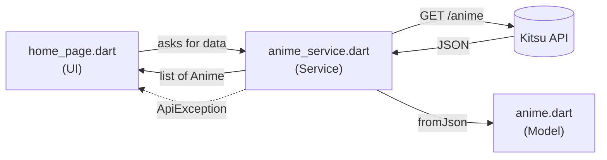
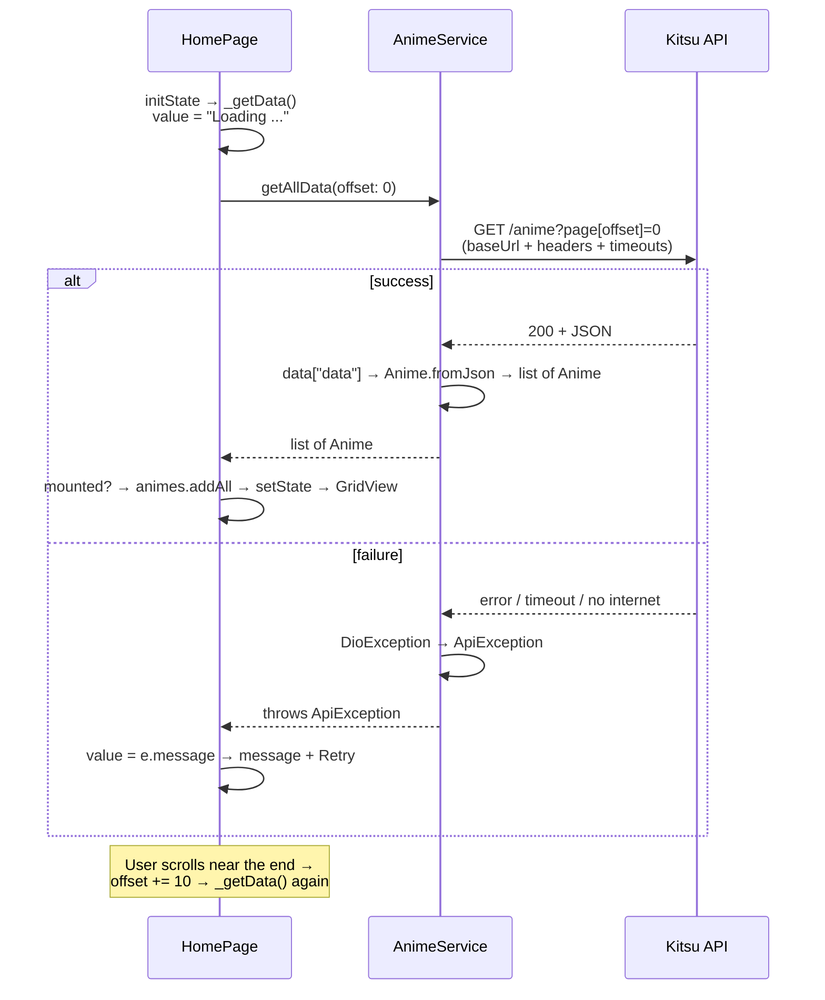

# Flutter Course: Section 7

### From a Practice API to a Real API: Kitsu Anime


In [Section 6](https://github.com/Atef-Mousa/flutter-course-section-6) we learned how networking works: requests, responses, HTTP methods, status codes and Dio error types. Most of that was done with **DummyJSON**, an API built for learning.

An API built for learning is friendly on purpose. A real API is not built for you. It has its own format, its own rules and its own surprises.
In this section we take everything from Section 6 and use it with a **real** API, [Kitsu](https://kitsu.docs.apiary.io/), to build an anime app with infinite scrolling.

This repository has the code from the section and a summary of every new concept, so you can use it to review and study.

> 📌 **This is the base project, not the finished app.**
> It shows the concepts and works when everything goes well. Making it ready for everything a real API can do is **your task in Google Classroom**. See [Your task](#your-task-google-classroom).

---

## Table of Contents

- [What's in this repository](#whats-in-this-repository)
- [How to study this section](#how-to-study-this-section)
- [Quick recap from Section 6](#quick-recap-from-section-6)
- [Concepts summary](#concepts-summary)
  - [1. Practice API vs real API](#1-practice-api-vs-real-api)
  - [2. Reading requests and responses with REST Client](#2-reading-requests-and-responses-with-rest-client)
  - [3. Headers: Accept and Content-Type](#3-headers-accept-and-content-type)
  - [4. BaseOptions: one place for the shared settings](#4-baseoptions-one-place-for-the-shared-settings)
  - [5. The model: from JSON to a Dart object](#5-the-model-from-json-to-a-dart-object)
  - [6. Error handling: our own ApiException](#6-error-handling-our-own-apiexception)
  - [7. Pagination: infinite scroll](#7-pagination-infinite-scroll)
  - [8. The UI: states, mounted and dispose](#8-the-ui-states-mounted-and-dispose)
- [The full flow](#the-full-flow)
- [Break it on purpose](#break-it-on-purpose)
- [Your task (Google Classroom)](#your-task-google-classroom)
- [What's next](#whats-next)
- [How to run the project](#how-to-run-the-project)
- [Check yourself](#check-yourself)
- [Resources](#resources)

---

## What's in this repository

```text
flutter-course-section-7/
├── lib/
│   ├── main.dart            App entry point (MaterialApp.router)
│   ├── router.dart          Routes: /home and /fav
│   ├── anime.dart           Model: the Anime class and fromJson
│   ├── anime_service.dart   Service: Dio settings and the API call
│   ├── api_exception.dart   Errors: turns Dio errors into clear messages
│   ├── home_page.dart       Screen: loading, error, grid and pagination
│   ├── anime_card.dart      Widget: one anime card
│   └── fav_page.dart        Favorites page (empty for now)
├── kitsu.http               30+ GET requests to explore Kitsu with the REST Client extension
└── README.md                You are here
```

Each file has **one job**. The UI never talks to Dio and never reads raw JSON:



---

## How to study this section

1. Install the **REST Client** extension in VS Code, open [`kitsu.http`](kitsu.http) and send every request. Read the headers and the body of each response.
2. Read the [Concepts summary](#concepts-summary) below, and open each file it points to.
3. Run the app, then do [Break it on purpose](#break-it-on-purpose) to see every error message yourself.
4. Answer [Check yourself](#check-yourself), then do [your task](#your-task-google-classroom) in Google Classroom.

---

## Quick recap from Section 6

You should already know these. If not, go back to the [Section 6 README](https://github.com/Atef-Mousa/flutter-course-section-6) first.

| Concept | One-line reminder |
| --- | --- |
| Client and server | The app sends a **request**, the server sends back a **response** |
| HTTP methods | GET read, POST create, PUT replace, PATCH change part, DELETE remove |
| Query parameters | After `?` in the URL. In Dio: `queryParameters: {...}` |
| JSON | Dio converts it for you: `{}` → `Map<String, dynamic>`, `[]` → `List` |
| Status codes | 2xx success, 4xx your request is wrong, 5xx the server has a problem |
| `DioException` | Thrown on any failure, **including** 4xx and 5xx responses. `e.type` tells you why |

---

## Concepts summary

### 1. Practice API vs real API

| | DummyJSON (Section 6) | Kitsu (Section 7) |
| --- | --- | --- |
| Built for | Learning | Real apps and real users |
| Response shape | Flat and simple: `data["posts"][0]["title"]` | Deeply nested: `data["data"][0]["attributes"]["posterImage"]["medium"]` |
| Format | Plain JSON (`application/json`) | **JSON:API** (`application/vnd.api+json`) |
| Data types | What you expect | Surprises: the rating is a **String** (`"82.28"`), not a number |
| Missing values | Every field is always there | Some fields can be **`null`** |
| Pagination | `limit` and `skip` | `page[limit]` and `page[offset]`, with brackets |
| Page size | You decide | **10 items** by default, **20 at most**. Ask for more → **400** |
| Amount of data | Small objects | More than 30 attributes per item; ask only for what you need with `fields[anime]` |
| Error details | Simple message | An `errors` array that explains exactly what you did wrong |
| Address | Stays the same | Can change: Kitsu moved from `kitsu.io` to `kitsu.app` |
| Wrong `Accept` header | Ignored | Rejected with **406 Not Acceptable** |

**The lesson:** with a real API, never guess. **Read the documentation and look at a real response before you write any code.**

### 2. Reading requests and responses with REST Client

Before writing Dart code, we send the request by hand and look at **everything** that goes and comes back. The [REST Client](https://marketplace.visualstudio.com/items?itemName=humao.rest-client) extension in VS Code lets you do this from a simple text file: [`kitsu.http`](kitsu.http).

```http
@base = https://kitsu.app/api/edge

### Get the first page of anime
GET {{base}}/anime
Accept: application/vnd.api+json
```

Click **Send Request** above a request, and you see the full response:

```http
HTTP/1.1 200 OK
Content-Type: application/vnd.api+json; charset=utf-8
...

{
  "data": [
    {
      "id": "1",
      "type": "anime",
      "attributes": {
        "slug": "cowboy-bebop",
        "description": "In the year 2071, humanity has colonized...",
        "averageRating": "82.28",
        "posterImage": {
          "tiny": "https://media.kitsu.app/.../tiny.jpg",
          "medium": "https://media.kitsu.app/.../medium.jpg"
        }
      }
    }
  ],
  "links": {
    "first": "...",
    "next": "...",
    "last": "..."
  }
}
```

What to notice:
- The list is inside `"data"`.
- The values we want are one level deeper, inside `"attributes"`.
- `"links"` tells us where the next page is.

#### What's inside `kitsu.http`

The file has more than 30 GET requests, grouped into parts. Send them in order. Every part teaches one idea you'll find in almost every real API:

| Part | Topic | Example | What you learn |
| --- | --- | --- | --- |
| 1 | Headers | `Accept: application/json` | Missing header → 200, wrong header → **406** |
| 2 | Pagination | `?page[limit]=20&page[offset]=10` | 10 items by default, **20 at most**; `meta.count` = total, `links.next` = next page |
| 3 | Only the data you need | `?fields[anime]=slug,averageRating` | The server sends only the fields you ask for |
| 4 | Sorting | `?sort=-averageRating` | `sort=x` small → big, `sort=-x` big → small |
| 5 | Filtering | `?filter[seasonYear]=2020&filter[subtype]=TV` | Get only the items that match; combine several filters |
| 6 | One item | `/anime/1` | The id goes in the **path**, and `data` is an **object**, not a list |
| 7 | Related data | `/anime/1/episodes`, `?include=categories` | Resources are connected; `include` fetches them in one request |
| 8 | Other endpoints | `/trending/anime`, `/categories` | One API has many resources |
| 9 | Errors | `?sort=banana` | A real API explains the mistake in an `errors` array |
| 10 | Real data is not perfect | `?filter[status]=upcoming` | Values you expected can be `null` |

#### Ask only for what you need

Each anime in Kitsu has **more than 30 attributes**: titles in many languages, rating statistics, cover images, dates, YouTube id... Our app uses only **4** of them. With `fields[anime]`, we tell the server which ones to send (part 3 of `kitsu.http`):

```http
GET {{base}}/anime?fields[anime]=slug,description,averageRating,posterImage
Accept: application/vnd.api+json
```

| Request | Size of 10 anime |
| --- | --- |
| `/anime` | about **60 KB** |
| `/anime?fields[anime]=slug,description,averageRating,posterImage` | about **15 KB** (4 times smaller) |

Less data means a faster response, less mobile data for the user, and less JSON to parse. Not every API supports this, so always check the documentation.

#### Errors that explain themselves

DummyJSON gave us simple errors. Kitsu tells us exactly what went wrong, in the body:

```json
{
  "errors": [
    {
      "title": "Invalid page value",
      "detail": "Limit exceeds maximum page size of 20.",
      "code": "118",
      "status": "400"
    }
  ]
}
```

When a request fails, **read the body, not only the status code**. In Dio, it is in `e.response?.data`.

### 3. Headers: Accept and Content-Type

Headers are extra information that travels with the request and the response.

| Header | Who sends it | Meaning |
| --- | --- | --- |
| `Accept` | Client (in the request) | "This is the format **I want back**" |
| `Content-Type` | Whoever sends a body | "This is the format of the body **I am sending**" |

Kitsu uses the **JSON:API** format, so its type is `application/vnd.api+json`, not the usual `application/json`.

**Try it yourself** with part 1 of `kitsu.http`:

| Request | `Accept` header | Result |
| --- | --- | --- |
| 1.1 | `application/vnd.api+json` | ✅ 200 OK |
| 1.2 | *(none)* | ✅ 200 OK: the server picks its default format |
| 1.3 | `application/json` | ❌ **406 Not Acceptable**: "I can't give you that format" |

So why send it at all if it works without it?
Because headers are a **contract** between the app and the server. Some servers are relaxed when a header is missing, and some are strict. Our code should say exactly what it expects instead of hoping the server is kind. That's why we put the headers in `BaseOptions`.

> The most famous header, `Authorization`, is not here yet. We'll add it in the authentication section, when we learn what a token is.

### 4. BaseOptions: one place for the shared settings

📄 `lib/anime_service.dart`

```dart
static final _dio = Dio(
  BaseOptions(
    baseUrl: "https://kitsu.app/api/edge",

    connectTimeout: const Duration(seconds: 10),
    receiveTimeout: const Duration(seconds: 15),
    sendTimeout: const Duration(seconds: 10),

    headers: {
      "Accept": "application/vnd.api+json",
      "Content-Type": "application/vnd.api+json",
    },
  ),
);
```

Everything in `BaseOptions` is added to **every** request this Dio instance sends. You write it once.

| Setting | What it does | When it fails, you get |
| --- | --- | --- |
| `baseUrl` | The common start of every URL. Then `_dio.get("/anime")` is enough | — |
| `connectTimeout` | Max time to **open the connection** to the server | `connectionTimeout` |
| `sendTimeout` | Max time to **upload** the request body (POST, PUT, uploads) | `sendTimeout` |
| `receiveTimeout` | Max time to **receive** the response | `receiveTimeout` |
| `headers` | Headers sent with every request | — |

Without timeouts, a request on a bad network can wait almost forever, and the user stares at "Loading ..." with no answer.

### 5. The model: from JSON to a Dart object

In Section 6 we said: *"In real projects we add an extra layer called a model."* This is it.

📄 `lib/anime.dart`

```dart
class Anime {
  final String id;
  final String name;
  final String desc;
  final String image;
  final String rating;

  const Anime({
    required this.id,
    required this.name,
    required this.desc,
    required this.image,
    required this.rating,
  });

  factory Anime.fromJson(Map<String, dynamic> data) {
    final id = data["id"];
    final name = data["attributes"]["slug"];
    final desc = data["attributes"]["description"];
    final image = data["attributes"]["posterImage"]["medium"];
    final rating = data["attributes"]["averageRating"];

    return Anime(id: id, name: name, desc: desc, image: image, rating: rating);
  }
}
```

**Why a model?**
- The UI writes `anime.name` instead of `item["attributes"]["slug"]`. That means fewer typos, and the editor can autocomplete it.
- Each value has a **type**, so mistakes show up early.
- If the API changes, you fix **one** place (`fromJson`), not every widget.

**`factory` constructor:** a constructor that can run code (here, reading the JSON) before it returns the object.

The service turns the whole list into models:

```dart
final data = response.data["data"] as List;
final List<Anime> animes = [];
for (var item in data) {
  animes.add(Anime.fromJson(item));
}
return animes;
```

```text
JSON text ──Dio──▶ Map<String, dynamic> ──fromJson──▶ Anime ──▶ List<Anime>
```

> 💡 **Think about it:** what happens to `fromJson` if a real anime has no rating and the API sends `"averageRating": null`? Send request 10.1 in `kitsu.http` and see for yourself. Keep this question in mind!

### 6. Error handling: our own ApiException

In Section 6 (`weather_app`), the service threw a plain `Exception`, and the UI had to clean up the text:

```dart
throw Exception('No internet connection.');
// in the UI:
_error = e.toString().replaceFirst('Exception: ', '');
```

That works, but the UI depends on the text format of `Exception`. Now we create **our own exception class** that carries a clean message.

📄 `lib/api_exception.dart`

```dart
class ApiException implements Exception {
  final String message;
  final int? statusCode;

  const ApiException(this.message, {this.statusCode});

  factory ApiException.fromDioException(DioException e) {
    switch (e.type) {
      case DioExceptionType.connectionTimeout:
        return const ApiException("Connection timed out. Please try again.");
      case DioExceptionType.connectionError:
        return const ApiException("No internet connection.");
      case DioExceptionType.badResponse:
        return ApiException._fromStatusCode(e.response?.statusCode);
      // ... one case for every DioExceptionType
    }
  }
}
```

For `badResponse`, the message depends on the status code:

| Code | Message |
| --- | --- |
| 400 | Bad request. |
| 401 | Unauthorized. Please log in again. |
| 403 | You don't have permission to do this. |
| 404 | Requested data was not found. |
| 429 | Too many requests. Slow down a little. |
| 500 / 502 / 503 | Server error. Please try again later. |

> **New in Dio 5:** `DioExceptionType.transformTimeout` (processing the response took too long). Because our `switch` covers every type, Dart **forces** us to handle it, or the code doesn't compile.

**Each layer has one job:**

```dart
// Service: TRANSLATES the error
try {
  ...
} on DioException catch (e) {
  throw ApiException.fromDioException(e);   // network or HTTP problem
} catch (e) {
  throw const ApiException("Failed to read data from the server.");  // e.g. unexpected JSON
}
```

```dart
// UI: SHOWS the error
try {
  final data = await AnimeService.getAllData(offset: offset);
  ...
} on ApiException catch (e) {
  setState(() => value = e.message);
}
```

> ❌ `catch (e) { rethrow; }` with nobody catching above it does nothing useful. The app still crashes and the user sees nothing.
> ✅ Translate the error into something meaningful, and catch it where you can show it.

### 7. Pagination: infinite scroll

A real API never sends all its data at once. Kitsu has thousands of anime, so it sends **pages** of 10.

| Request | Items |
| --- | --- |
| `/anime?page[offset]=0` | 1 – 10 |
| `/anime?page[offset]=10` | 11 – 20 |
| `/anime?page[offset]=20` | 21 – 30 |

📄 `lib/home_page.dart`

```dart
_scrollController.addListener(() {
  if (_scrollController.position.pixels + 200 >
      _scrollController.position.maxScrollExtent) {
    offset += 10;
    _getData();
  }
});
```

| Part | Meaning |
| --- | --- |
| `position.pixels` | How far the user has scrolled |
| `position.maxScrollExtent` | Where the list ends |
| `+ 200` | Start loading a little **before** the end, so scrolling feels smooth |
| `animes.addAll(data)` | New items are **added** to the list, not replacing it |

And in the service, Dio builds the URL from the map:

```dart
_dio.get("/anime", queryParameters: {"page[offset]": offset});
```

### 8. The UI: states, mounted and dispose

📄 `lib/home_page.dart`

**Start loading when the page opens.** `initState` runs once, when the widget is created:

```dart
@override
void initState() {
  super.initState();
  _getData();
  ...
}
```

**Show the state while the list is empty.** `value` holds the current status: `"Loading ..."`, or the error message. If it's an error, the user gets a **Retry** button:

```dart
if (animes.isEmpty) {
  return Scaffold(
    body: Center(
      child: Column(
        mainAxisSize: MainAxisSize.min,
        children: [
          Text(value, textAlign: TextAlign.center),
          const SizedBox(height: 12),
          if (value != "Loading ...")
            ElevatedButton(onPressed: _getData, child: const Text("Retry")),
        ],
      ),
    ),
  );
}
// otherwise: the GridView of anime cards
```

**`mounted`: is the page still on the screen?** A request can take seconds. If the user leaves the page before it finishes, calling `setState` on a removed widget is an error. So after every `await`, check first:

```dart
final data = await AnimeService.getAllData(offset: offset);
if (!mounted) return;
setState(() { ... });
```

**`dispose`: clean up after yourself.** A `ScrollController` keeps listeners in memory. If we don't dispose it, it stays there after the page is gone (a **memory leak**).

```dart
@override
void dispose() {
  _scrollController.dispose();
  super.dispose();
}
```

> **Rule:** if you create a controller in a `State`, dispose it in `dispose()`.

**Images from the network.** 📄 `lib/anime_card.dart`. If an image fails to load, `errorBuilder` shows something else instead of breaking the card:

```dart
Image.network(
  anime.image,
  errorBuilder: (context, object, trace) => Container(color: Colors.red),
)
```

---

## The full flow



---

## Break it on purpose

The best way to understand errors is to cause them. Try each one, read the message, then undo the change.

| Do this | Where | Message you should see |
| --- | --- | --- |
| Turn off your internet, then start the app | Your device | No internet connection. |
| Change `"/anime"` to `"/animee"` | `anime_service.dart` | Requested data was not found. |
| Set `connectTimeout` to `Duration(milliseconds: 1)` | `anime_service.dart` | Connection timed out. Please try again. |
| Change the `Accept` header to `"application/json"` | `anime_service.dart` | Unexpected error (406). |
| Change `["data"]` to `["dataa"]` | `anime_service.dart` | Failed to read data from the server. |

Then turn your internet back on and press **Retry**.

---

## Your task (Google Classroom)

This repository is the **base project**: it shows the concepts, and it works when everything goes well.

But a real API doesn't always go well. In **Google Classroom** you'll find a task that takes this base project and makes it **real**: an app that keeps working when a real API surprises it. All the details and requirements are in the task.

Before you start it, make sure you:
- sent every request in [`kitsu.http`](kitsu.http) and read the responses, especially **part 10**,
- tried every row of [Break it on purpose](#break-it-on-purpose),
- can answer [Check yourself](#check-yourself) without looking.

---

## What's next

**Section 8: State management with Riverpod.** We'll start with a recap of the Classroom task. Then we'll see how Riverpod replaces our `value` string with a clean way to handle loading, error and data.

**After that: Authentication.** We'll learn what a **JWT** token is, how its **digital signature** works, how to store it safely, and how **interceptors** add the `Authorization` header to every request for us.

---

## How to run the project

You need Flutter installed with **Dart 3.13.1 or newer**. This code was written with Flutter 3.47.1.

```bash
git clone https://github.com/Atef-Mousa/flutter-course-section-7.git
cd flutter-course-section-7

flutter pub get
flutter run
```

Kitsu is free and needs **no API key** to read anime, so the app works right away.

To try the requests in `kitsu.http`, install the [REST Client](https://marketplace.visualstudio.com/items?itemName=humao.rest-client) extension in VS Code, open the file, and click **Send Request** above any request.

---

## Check yourself

You are ready for the next section if you can answer these without looking:

1. Give three differences between DummyJSON and Kitsu.
2. What is the difference between the `Accept` and `Content-Type` headers?
3. The request works without an `Accept` header, but fails with `Accept: application/json`. Why? Which status code do you get?
4. Why do we put the headers in `BaseOptions` and not in each request?
5. Explain `connectTimeout`, `sendTimeout` and `receiveTimeout` with a real-life example for each.
6. Why do we use a model instead of reading the `Map` directly in the UI?
7. Why did we create `ApiException` instead of throwing a plain `Exception`?
8. Why is `catch (e) { rethrow; }` not enough on its own?
9. Why do we check `mounted` after `await`?
10. What happens if we never call `_scrollController.dispose()`?
11. How does `page[offset]` work? How many items does Kitsu send per page by default, and at most?
12. What does `fields[anime]=...` do, and why does it make the app faster?
13. What is the difference between `sort=averageRating` and `sort=-averageRating`?
14. In `/anime` the `data` is a list, but in `/anime/1` it is an object. Why does this matter when you write `fromJson`?
15. A request fails with 400. Where do you look to find out exactly why?

---

## Resources

- [Section 6 repository](https://github.com/Atef-Mousa/flutter-course-section-6)
- [dio package](https://pub.dev/packages/dio)
- [Kitsu API documentation](https://kitsu.docs.apiary.io/)
- [JSON:API specification](https://jsonapi.org/)
- [REST Client extension for VS Code](https://marketplace.visualstudio.com/items?itemName=humao.rest-client)
- [HTTP status codes on MDN](https://developer.mozilla.org/en-US/docs/Web/HTTP/Status)
